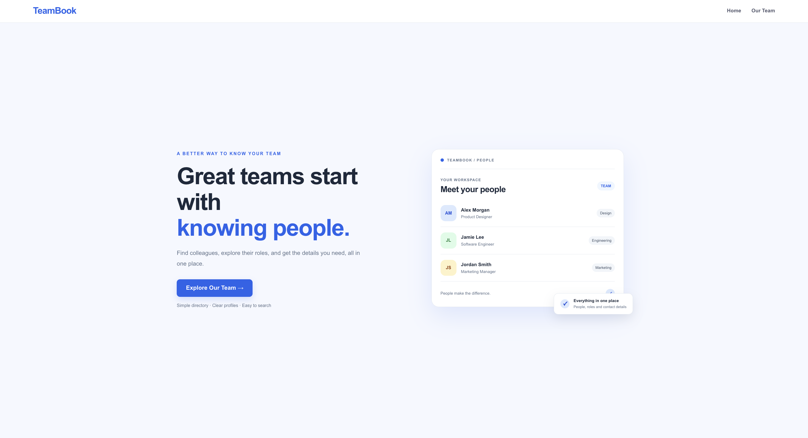

# TeamBook — Employee Directory

TeamBook is a simple employee directory where users can search for employees and view their profiles. It uses React and the DummyJSON API to display employee information.

## Project Details

- **Problem Statement:** PS7
- **Project Name:** TeamBook
- **Frontend:** React.js, Vite
- **Routing:** React Router
- **API:** DummyJSON Users API
- **Styling:** CSS

## Features

- View a list of employees.
- Search employees by their names.
- View individual employee profiles.
- Display employee contact and company information.
- Navigate between pages using React Router.
- Show loading and error messages.
- Display a 404 page for unknown routes.
- Responsive layout for smaller screens.

## API Used

Employee list:

`https://dummyjson.com/users?limit=30`

Individual employee:

`https://dummyjson.com/users/:id`

## Routes

| Route | Description |
|---|---|
| `/` | Home page |
| `/employees` | Employee directory and search |
| `/employees/:id` | Individual employee profile |
| `*` | Page not found |

## Screenshots

### Home Page

### Employee Directory

## Run Locally

1. Clone the repository.
2. Open the project folder in the terminal.
3. Install dependencies:

   `npm install`

4. Start the development server:

   `npm run dev`

## Live Demo

Deployment link will be added after the website is published.

## Author

Arhan Dev Singh